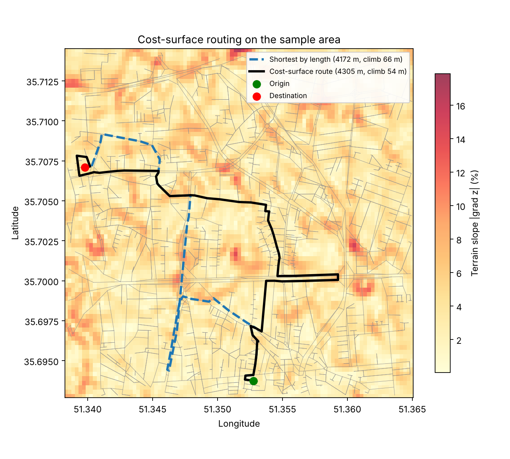

# Bicycle Route Planning in Tehran with Differential Geometry and Cost Surfaces

An interactive app that suggests a bicycle route between two points in Tehran. The route is not simply the shortest one: the effort of riding each street depends on the **terrain**. The terrain is a surface `z(x, y)` taken from a Digital Elevation Model (DEM), and the effort along a street is computed from the **directional derivative of the elevation along the street**, so climbing costs more than descending. The least-cost route is found with Dijkstra's algorithm.

> Course project for *Differential Geometry*, Iran University of Science and Technology (5th semester).
> Developed in December 2025, extended and published on GitHub in November 2026.

## Example



The background is the terrain slope, the gray lines are the streets of the sample area. The dashed blue line is the shortest route by length; the black line is the route chosen with the cost surface.

The terrain of the sample area is gentle (median slope 3.6 %, 95 % of the area below 8 %), so the effect is modest. On 253 random origin–destination pairs, 66 pairs (26 %) get a different route than the shortest one. Over those 66 pairs the cost-surface route is on median 0.4 % longer and has 3.7 % less total climb. The pair in the figure was picked for a clear contrast: the route is 3 % longer (4172 m to 4305 m) and has 18 % less climb (66 m to 54 m). The numbers can be reproduced with `python scripts/compare_routes.py`.

## How it works

1. **Terrain surface and its gradient.** The DEM gives the elevation `z` on a regular grid. After filling missing cells and a light Gaussian smoothing (the elevations are whole metres), the gradient of the surface is computed with finite differences and converted to metres of rise per metre of run:

   ```
   grad z = (dz/dx, dz/dy)
   ```

2. **Street network.** The streets come from OpenStreetMap through OSMnx as a directed graph. Every edge is a curve `gamma(s)` (its geometry when available, otherwise the straight line between its end nodes).
3. **Directional derivative along a street.** For a street with unit tangent `T`, the signed grade is the directional derivative of the elevation along the street

   ```
   g(s) = grad z . T        (positive uphill, negative downhill)
   ```

   Reversing the direction of travel changes the sign of `g`, so the cost of an edge depends on the direction.
4. **Cost of an edge.** The cost is a line integral of an effort multiplier `m` along the street, evaluated on pieces of at most 10 m:

   ```
   cost = integral of m(g(s)) ds
   m(g) = 1 + 30 * max(g, 0) + 5 * max(-g, 0)
   ```

   On the flat, `m = 1` and the cost is the length in metres. A 5 % climb costs 2.5 times as much as the flat, a 5 % descent 1.25 times. The two constants are hand-chosen heuristic values, not fitted to cyclist data. The total climb and descent of each edge are stored as well, so routes can be compared by climb.
5. **Routing.** The origin and destination clicked on the map are snapped to the nearest graph nodes, and `networkx.shortest_path` with `weight="cost"` returns the least-cost route.

The formulas are checked in `tests/test_routing.py` against a synthetic terrain: on a plane rising 5 % to the north, a 100 m street going north costs 250 with 5 m of climb, going south costs 125 with 5 m of descent, and going east costs 100.

## Project layout

```
app.py                 Streamlit app (map, clicks, route)
routing.py             terrain gradient and edge costs (directional derivative)
sample_data/           small street graph and DEM crop of central Tehran (included)
scripts/               scripts that build the data and compare routes
tests/                 check of the cost formulas on a synthetic terrain
docs/                  figures
archive/               full-city version of the app (disabled code, see below)
```

## Setup

Requires Python 3.10+.

```bash
python -m venv .venv
source .venv/bin/activate
pip install -r requirements.txt
streamlit run app.py
```

Click once on the map for the origin and once for the destination, then press **Compute route**. The sample area is about 2.4 km × 2.4 km around the University of Tehran area; clicks outside the street network snap to the nearest street.

## Data

| File | Content | In repo |
|---|---|---|
| `sample_data/small_tehran.graphml` | street graph (OSM, `drive` network, 1.2 km around 35.7036 N, 51.3517 E) | yes |
| `sample_data/tehran_dem_small.tif` | DEM crop covering that graph (1 arc-second grid, about 30 m cells) | yes |
| `data/tehran_dem.tif` | DEM of the Tehran region | no (about 99 MB) |
| `data/tehran.osm`, `data/iran-latest.osm*` | OpenStreetMap extracts | no (very large) |
| `data/tehran_drive.graphml`, `data/tehran_bike.graphml` | full-city graphs (about 160 MB each) | no |

Street data © OpenStreetMap contributors, available under the ODbL.

To rebuild the sample data yourself (needs internet for the graph and the large DEM in `data/`):

```bash
python scripts/smallgraph.py   # street graph around the sample centre
python scripts/smalldem.py     # crop the DEM to the same area
```

`scripts/generategraf.py` and `scripts/generatebikegraph.py` build the full-city graphs used by the archived full-city app.

## Limitations

- **Heuristic effort model.** The multiplier `m(g)` and its two constants are simple choices, not a physical or fitted model of cycling effort. Speed, rider weight, road surface and traffic are not modelled.
- **DEM resolution.** The DEM has about 30 m cells and whole-metre elevations, so the gradient is smoothed and approximate. Short streets and small hills are not resolved.
- **Gentle terrain.** In the sample area the cost-surface route differs from the shortest route for about a quarter of the pairs and changes the climb by a few percent. The method matters more on hillier terrain such as the north of Tehran.
- **Not bike-specific.** The sample graph is the drive network: it has one-way streets and no cycleway information, and the cost does not model road safety.
- **Sample area only.** The app works on one small area. A full-city version of the earlier cost function, with a street-type penalty, a cycleway bonus and a fallback to the full road graph, is kept in `archive/app_fullcity.py`; its code is commented out and it needs the large files above.
- **No validation** against real cycling data.

## Development notes

The original course version used a cost made of the edge length, the DEM slope magnitude sampled at the two end nodes, and a small term from the straight-line distance between the end nodes. It cropped the DEM to a window that did not overlap the street graph and swapped the row and column indices when reading the DEM, so the slope term was not meaningful. In November 2026 this was replaced by the directional-derivative line integral above (`routing.py`), with a new DEM crop.
